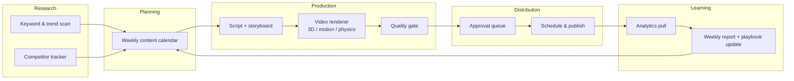

# Vital Acoustica — Social Media Agent Blueprint

Status: **draft v0.1** — nothing is built yet. This document is the plan we agree on before writing code.

## 1. Goal

An agent ("the manager") that runs Vital Acoustica's social media end to end:

| Job | What it means in practice |
|---|---|
| **Create** | One post per day: an educational or product video (code-rendered 3D / motion / physics), caption, hashtags, thumbnail |
| **Schedule & post** | Queue each post at the best time per network, publish automatically |
| **Analyze** | Pull performance daily, write a weekly report, learn what works |
| **Find competitors** | Discover and track similar accounts, spot their outlier posts |
| **Find keywords** | Track which topics, keywords and hashtags are performing, feed them into the next week's plan |

Everything follows a fixed **template system** (section 5) so the feed looks like one brand, not 30 random posts.

## 2. Company profile

- **Vital Acoustica** — professional sound and lighting hire, with the crew to run it
- Tagline: *Sound is felt. Light is experienced.*
- Also builds **software plugins**, **lighting connectors** and other audio/lighting hardware and software
- Market: **Karnataka** for now
- Website: https://vitalacoustica.com · Instagram: @vitalacoustica

Full brand kit (colours, fonts) is in [`brand/brand-kit.md`](brand/brand-kit.md); the same values as CSS tokens for the renderer are in [`brand/tokens.css`](brand/tokens.css).

## 3. Architecture



The agent is **Claude Code running on a schedule in this repository**. The repo is its memory: brand rules, templates, the calendar, every post it made, and every metric it pulled are files here. Each scheduled run reads state, does one job, commits the result.

### Tools (already connected to this workspace)

| Capability | Tool | Used for |
|---|---|---|
| Scheduling, publishing, analytics | **Metricool** | Schedule posts (with or without review step), best-time-to-post, per-network metrics |
| Keywords, competitors, trends | **vidIQ** | Keyword research, outlier videos, similar channels, competitor lists, Instagram/TikTok outliers, title scoring |
| Video rendering | **Code in this repo** | Three.js (3D) + a physics engine + GSAP (motion), rendered headless to MP4 |
| Voiceover | **ElevenLabs** (not yet connected to this workspace — vidIQ voiceover is the fallback) | Narration on every video |
| Music | **vidIQ** | Background music bed |
| Stills, thumbnails, b-roll | **OpenArt** | Generated images where code-rendered visuals are not enough |
| Hosted video projects | **HyperFrames** | Optional: shareable, cloud-rendered versions of a composition |

### Why code-rendered video

"Simple 3D, motion and physics" is exactly what a browser scene can do deterministically: a sound wave leaving a speaker, two subs cancelling, a beam hitting a surface. Each video is a small HTML scene driven by a JSON spec, so the agent can produce a new one daily by changing data, not by re-inventing a video. It costs no generation credits and is always on-brand.

## 4. Content strategy

### Pillars

| Pillar | Share | Examples |
|---|---|---|
| **Sound physics explained** | 35% | Why line arrays curve · inverse-square law · phase cancellation · cardioid sub arrays · room modes · delay towers |
| **Light explained** | 20% | Beam angle vs. throw distance · DMX in 30 seconds · colour mixing · haze and why beams appear |
| **Products & builds** | 20% | Plugin features · lighting connector demos · "how we built it" |
| **Rental & event know-how** | 15% | How much PA for 200 people · power planning · rigging checklist · common mistakes |
| **Proof & people** | 10% | Event recaps, client results, behind the scenes (needs real footage from the team) |

### Weekly rhythm (draft)

| Day | Slot |
|---|---|
| Mon | Sound physics explainer |
| Tue | Product / plugin feature |
| Wed | Light explainer |
| Thu | Rental know-how ("how much PA do I need…") |
| Fri | Sound physics explainer (trend- or keyword-led) |
| Sat | Event / behind the scenes |
| Sun | Myth vs. fact or quiz |

## 5. Template system

### Video template (vertical 9:16, 20–40 s, voiceover + on-screen text)

| Beat | Time | Content |
|---|---|---|
| **Hook** | 0–2 s | One question or claim on screen ("Why do two subs get *quieter*?") |
| **Setup** | 2–8 s | The scene appears: speakers, room, fixture |
| **Demo** | 8–28 s | The physics plays out — waves, particles, beams, with 2–3 labels |
| **Takeaway** | 28–35 s | One sentence to remember |
| **Brand card** | last 3 s | Logo, handle, call to action |

Fixed across every video: Obsidian background, Ivory text, Brass as the single accent (wave fronts, beams, highlights), Instrument Serif hooks with italic emphasis, Manrope capitals for labels, logo position, caption safe zones, intro/outro sting, one consistent narrator voice.

### Scene library (reusable building blocks)

`wave-propagation` · `interference` · `line-array-coverage` · `sub-array-polar` · `room-modes` · `beam-cone` · `colour-mix` · `dmx-signal-chain` · `product-turntable` · `number-comparison`

A daily post = one scene + a spec file:

```json
{
  "scene": "interference",
  "hook": "Why do two subs get quieter?",
  "params": { "sources": 2, "spacing_m": 1.7, "freq_hz": 100 },
  "labels": ["Peak meets trough", "Cancellation zone"],
  "takeaway": "Spacing is half a wavelength at 100 Hz — move them together.",
  "cta": "Planning an event? Link in bio."
}
```

### Caption template

```
[Hook line — restates the question]

[2–3 short lines of explanation]

[Practical tip tied to rental or product]

[CTA]

[5–8 hashtags: 2 brand, 3 topic, 2–3 keyword-research driven]
```

## 6. Operating loops

| Loop | When | What the agent does | Output |
|---|---|---|---|
| **Daily produce** | Every day, early | Take today's calendar slot → write spec → render video → quality gate → send to approval queue / schedule | `posts/YYYY-MM-DD/` |
| **Daily measure** | Every day, late | Pull metrics for posts from the last 7 days | `analytics/daily/` |
| **Weekly plan** | Sunday | Analytics review + keyword scan + competitor outliers → next week's calendar | `calendar/YYYY-Www.md`, `reports/weekly/` |
| **Monthly research** | 1st of month | Refresh competitor list, pillar performance, keyword bank; propose strategy changes | `research/`, `reports/monthly/` |

### Quality gate (before anything is queued)

- Video renders, correct duration and resolution, no clipped text in safe zones
- Physics claim checked against the fact sheet in `brand/facts.md` (no wrong numbers going out under the company name)
- Caption follows template, no banned words, hashtags within limits
- Not a near-duplicate of a post from the last 60 days

### Approval

Start with **the owner approving every post** (Metricool's review flow), move to autopilot per pillar once a pillar has two clean weeks. Proof & people posts always need approval because they involve real clients.

## 7. Repository layout

```
brand/          company.md, voice.md, palette + logo, facts.md, banned.md
templates/      video beat templates, caption templates
scenes/         reusable 3D/physics scenes (HTML + JS)
renderer/       spec → MP4 pipeline
calendar/       weekly plans
posts/          one folder per post: spec, video, caption, post IDs
research/       competitors.md, keywords.md, trend notes
analytics/      raw daily metric pulls
reports/        weekly and monthly reports
playbook.md     what the agent has learned (updated weekly)
.claude/        skills for each loop (produce, measure, plan, research)
```

## 8. Build phases

| Phase | Deliverable | Done when |
|---|---|---|
| **0. Foundations** | Brand files, accounts connected, platforms chosen | Section 10 questions answered |
| **1. Renderer spike** | One scene (`interference`) rendered to a 30 s vertical MP4 from a spec | Video plays correctly on a phone and looks on-brand |
| **2. Template system** | Beat template, brand card, 4 scenes, caption generator | 7 varied videos produced from specs alone |
| **3. Publish path** | Spec → render → approval → scheduled post | One real post goes live through the pipeline |
| **4. Research** | Competitor list, keyword bank, weekly plan loop | Agent writes next week's calendar unaided |
| **5. Analytics & learning** | Daily pulls, weekly report, playbook updates | Report explains what worked and changes the plan |
| **6. Automation** | Scheduled runs for all four loops | A full week runs with approvals only |

## 9. Risks

| Risk | Mitigation |
|---|---|
| Technically wrong explainer damages credibility with audio professionals | Fact sheet + quality gate; approval stays on for physics content until trusted |
| Feed feels repetitive | Scene library grows monthly; duplicate check; Saturday slot uses real footage |
| Media hosting — schedulers need a public URL for each video | Resolve in phase 3 (to be tested, not yet verified) |
| Platform rate limits / API changes | Metricool as the single publishing layer; failures reported, never silently skipped |
| Real footage dependence for "Proof & people" | Shared folder the team drops clips into; slot falls back to a know-how post if empty |

## 10. Decisions and open items

### Decided

| Topic | Decision |
|---|---|
| Platforms | Instagram Reels and YouTube Shorts first; X and LinkedIn added once the accounts are created |
| Market | Karnataka for now — posting times and local keywords follow from this |
| Approval | The owner approves every post |
| Audio | Voiceover on every video |
| Brand | Kit recorded in `brand/` |

### Still open

1. **Connect the accounts.** Metricool and vidIQ currently hold only the **whatiffun** brand. @vitalacoustica needs to be added as a brand in Metricool (and connected in vidIQ) before the agent can schedule, post or read analytics for it.
2. **YouTube.** Does a Vital Acoustica YouTube channel exist for Shorts, or should one be created?
3. **ElevenLabs.** No ElevenLabs connector is available in this workspace yet. Connect it, or use vidIQ's voiceover until then.
4. **Logo files.** SVG or transparent PNG, light and dark versions.
5. **Company details.** Named products (plugins, connectors), services list and typical customers, for the Products and Rental pillars.
6. **Voice.** Narrator language(s) — English only, or Kannada as well? — and a preferred voice.
